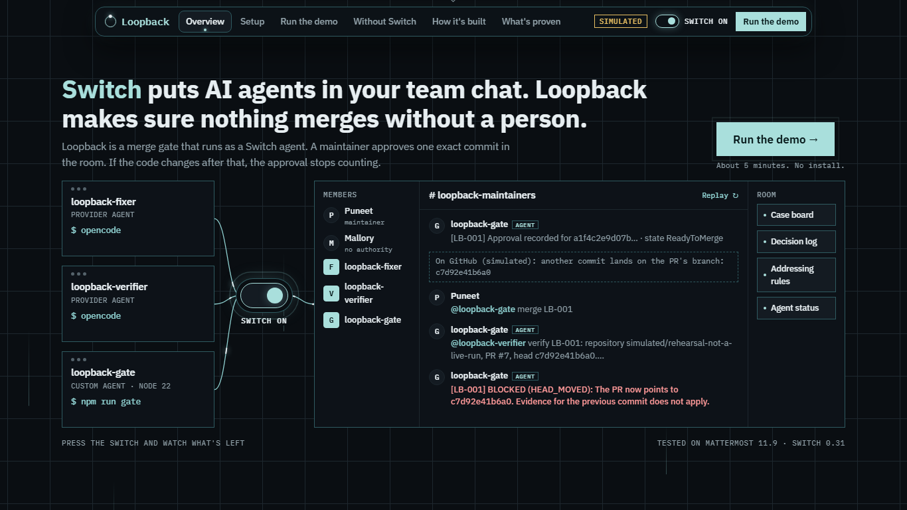
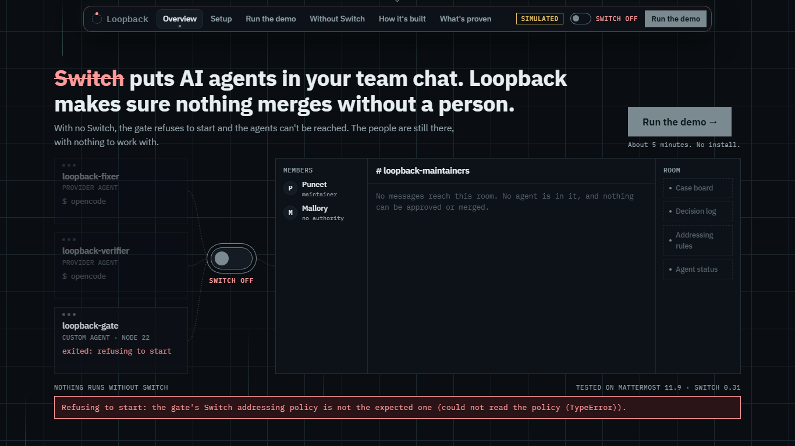
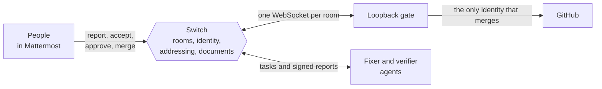
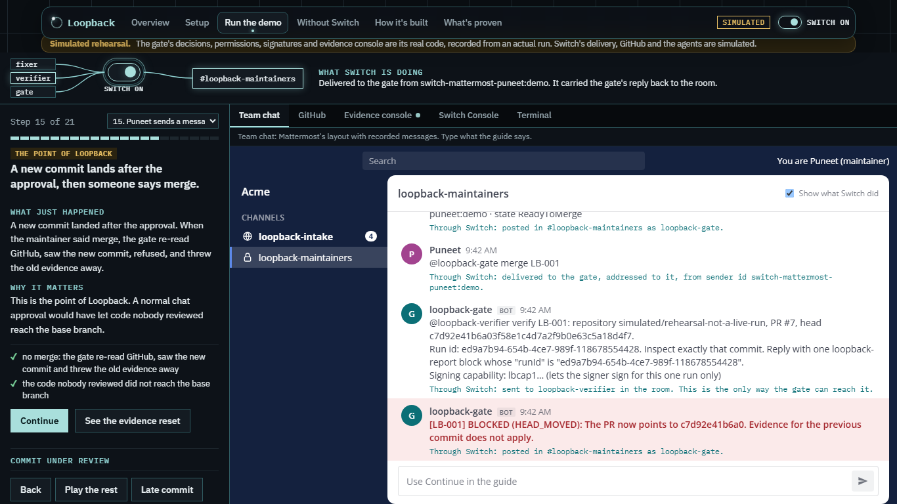
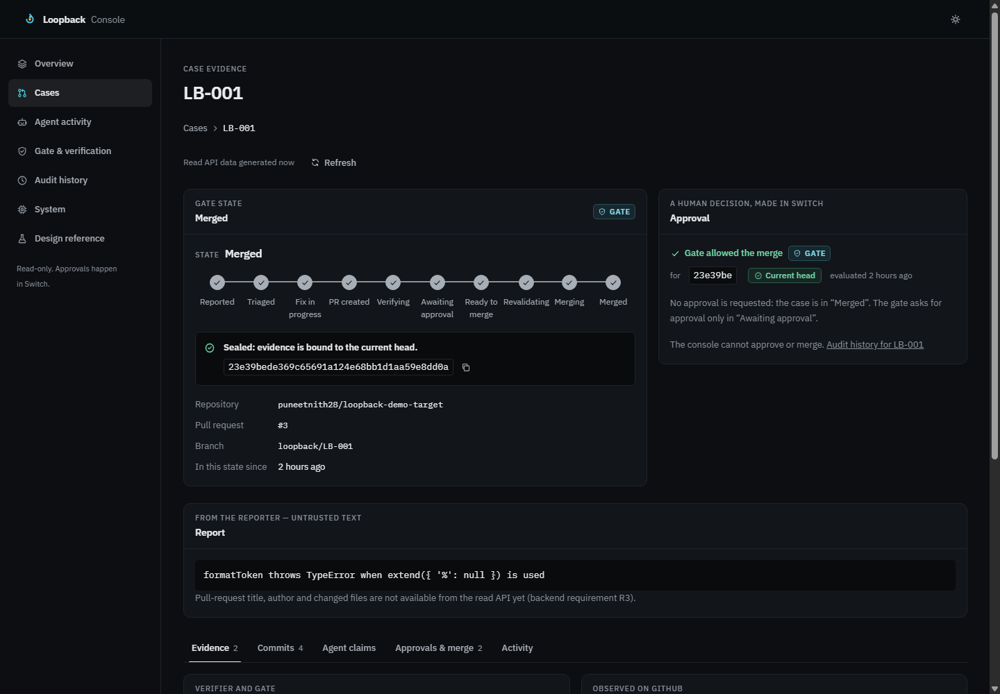
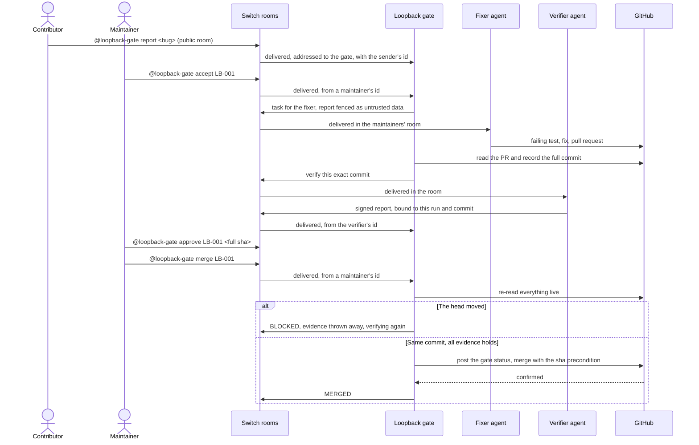
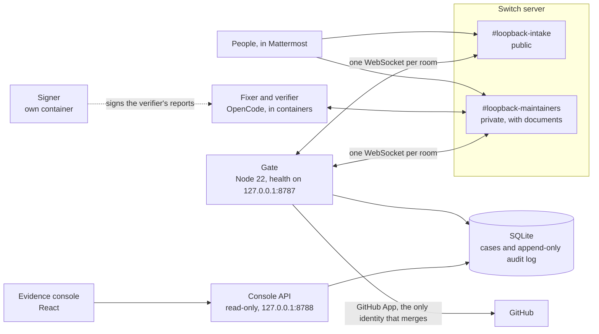

# Loopback

[](https://github.com/puneetnith28/Loopback/actions/workflows/ci.yml)
[](https://github.com/puneetnith28/Loopback/actions/workflows/codeql.yml)

**Switch puts your people and your AI coding agents in the same chat rooms. Loopback is the agent in those rooms that decides what may merge.**
*Turn Switch off, and nothing is left to merge.*

A contributor reports a bug in chat. A coding agent writes a fix in minutes and opens a pull request. A maintainer skims it and types "looks good". Then one more commit lands on the branch, from the agent finishing up or from anyone with push access, and the merge takes that too. Or the agent says its tests passed when they never ran. Or the bug report carried instructions aimed at the agent. In most chat setups nothing can tell a maintainer's "looks good" from anyone typing the same words, and nothing ties it to the code that was looked at.

[Switch](https://github.com/sandbox-quantum/switch) is what makes this solvable. It runs the rooms, connects the agents, and tells every agent **exactly who sent each message, in which room, and whether it was addressed to them**. Loopback is a custom Switch agent that builds on those facts: a maintainer, identified by their Switch id, approves one full 40-character commit, and before merging the gate re-reads GitHub. **If the pull request points anywhere else, the approval and all the evidence stop counting.** Everything a person or agent does passes through Switch first, so without Switch the gate has no people, no agents and no authority, and it refuses to start.

It is not an autonomous agent, and it does not judge code. It decides whether the evidence for one exact commit is complete, and it is the only identity allowed to merge.

**Start here:** [Try it in your browser, no install](https://claude.ai/artifact/JWwtrnBgQ6UjhvpymQp5Nf) · [Switch is the workflow](#switch-is-the-workflow) · [Run it](#run-it) · [What is proven](#what-is-verified-and-what-is-not) · [Evaluate it](TESTING.md) · [How it works](docs/architecture.md) · [All the docs](docs/README.md)

Built on Switch for the Flip the Switch hackathon, Best Business Workflow track.

---

## Switch is the workflow

| | |
|---|---|
|  |  |
| **Switch on.** The fixer, the verifier and the gate reach the maintainers' room only through Switch. Here a commit landed after approval, and the gate refused with `HEAD_MOVED`. | **Switch off.** The agents can't be reached, the room is empty, and the gate refuses to start. The red line is the gate's own wording. |

Captured from the [demo page](https://claude.ai/artifact/JWwtrnBgQ6UjhvpymQp5Nf) by `node scripts/demo-page/screenshots.mjs`. Its chat messages are recorded from a run of the gate's real code; Switch's delivery, GitHub and the agents are simulated there, and the page says so on every screen.

Every arrow below passes through Switch. GitHub only ever hears from the gate.



| Switch provides | What Loopback does with it | Without it |
|---|---|---|
| **Rooms** on a chat app (Mattermost here) | A public room for reports, and a private maintainers' room where people and agents work | Nobody can report, accept, approve or merge. The gate has no other way to hear a person |
| **The agent connection** | The gate holds one WebSocket per room over [Switch's agent protocol](https://docs.switchagents.ai/switch-rooms/internals/agent-protocol.md), with reconnect and takeover fencing (`apps/switch-gate/src/switch/connection.ts`) | Nothing reaches the gate |
| **Provider agents** run by Switch Console | The fixer and verifier are OpenCode sessions, each with its own identity. The gate tasks them only by message in the room | No fix is written or checked |
| **Sender identity** | An approval counts only from an exact Switch participant id on the maintainers' list, never a display name | Anyone could type a maintainer's name |
| **Addressing policy** | Switch decides who may address the gate. The gate refuses to start unless the policy is the expected restrictive one, and stops if it changes | The gate's permissions would have nothing to stand on |
| **Room documents** | A live case board and decision log in the room. Only their author can change them through the agent API, so agents read them but can't rewrite them | The team needs another tool to see where work stands |
| **Room status** | `team` shows whether each agent is really connected, and the gate warns when it tasks one that isn't | A task to an absent agent waits in silence |
| **Templates** | [One file](templates/loopback.template.yaml) creates both agents and both rooms | Each room and agent is set up by hand |

### What happens without Switch

This is not a fallback mode. When the gate starts, it reads its addressing policy from Switch and lists the Switch operations it may use. If it can't, it stops. Started with Switch unreachable, it printed:

```text
Refusing to start: the gate's Switch addressing policy is not the expected one (could not read the policy (TypeError)).
```

While it runs, it reads the policy again every 60 seconds (`POLICY_RECHECK_MS` in `apps/switch-gate/src/run.ts`) and stops if it has changed. GitHub is the source of truth for code; Switch is the source of truth for who said what, and where. Loopback has no way to replace either.

Live-tested on Slack and on Mattermost, which comes with Switch. The gate speaks only to Switch, so the chat app is Switch's choice. For Slack, Switch's bridge turns Slack's mention codes back into `@loopback-gate`, and the gate decodes the `&lt;`, `&gt;` and `&amp;` that Slack leaves in people's text; [`docs/setup.md`](docs/setup.md#3-using-slack-instead-of-mattermost) covers what differs. The first recorded end-to-end run (report to merge, PR #3) was made on Mattermost; the full case in the demo video, including a merge refused after the branch moved, ran on Slack (PR #8). The other chat apps Switch bridges have not been tried.

---

## Run it

> **Evaluating this?** [`TESTING.md`](TESTING.md) is written for you, starting with a web page that needs nothing installed.

Needs Node `>=22.13.0 <23` (the range in `package.json`) and Git. No accounts, tokens or Docker for this part.

```bash
git clone https://github.com/puneetnith28/Loopback.git
cd Loopback
npm ci          # about 50 s
npm run build   # about 6 s
npm run demo    # about 25 s at reading pace; npm run demo:fast skips the pauses
```

Timed from a clean clone on Windows 11 with Node 22.15.1. No C++ toolchain is needed: `.npmrc` turns off install scripts, and `better-sqlite3` ships prebuilt binaries.

`npm run demo` takes one bug from a public report to a merge, with the attacks and mistakes the gate exists to stop, and **checks itself**: every scene states what must happen, and the run exits with code 1 if any of the 16 outcomes does not. The router, permissions, state machine, merge policy, audit log and signatures are the code the live gate runs; Switch's delivery, GitHub and the agents are stand-ins (`apps/switch-gate/src/demo/rehearsal.ts`). Each message carries a Switch-style sender id, and the gate's permission checks run on it exactly as they do live. This is the late commit, as it prints:

```text
11. THE POINT OF LOOPBACK. A new commit lands after the approval, then someone says merge.
  [on GitHub, simulated] another commit lands on the PR's branch: c7d92e41b6a0
  #loopback-maintainers Puneet (maintainer): @loopback-gate merge LB-001
  #loopback-maintainers loopback-gate: @loopback-verifier verify LB-001: repository simulated/rehearsal-not-a-live-run, PR #7, head c7d92e41b6a03f58e1c4d7a2f9b0e63c5a18d4f7.
  #loopback-maintainers loopback-gate: [LB-001] BLOCKED (HEAD_MOVED): The PR now points to c7d92e41b6a0. Evidence for the previous commit does not apply.
  ✓ no merge: the gate re-read GitHub, saw the new commit and threw the old evidence away
  ✓ the code nobody reviewed did not reach the base branch
```

| Command | What it does |
|---|---|
| `npm run demo:console` | The same rehearsal, then the real console API over its case on port 8788 |
| `npm run dev --workspace apps/console` | The evidence console, at `http://localhost:5173` |
| `npm run demo:page` | Rebuilds the web page in `docs/demo/loopback-demo.html` from a fresh run |
| `npm run demo:check` | Plays that page in Chromium at every size, and fails on anything broken |
| `npm run readiness` | For a live setup: lists everything still missing, Switch included |
| `npm run gate` | Starts the gate, reading `.env` |

Running it on your own repository takes a few hours the first time, because each role gets its own credentials: Switch Console with Docker, a GitHub App for the gate, limited tokens for the agents, and a coding agent. [`docs/setup.md`](docs/setup.md) walks through GitHub, then Switch, and [`docs/windows.md`](docs/windows.md) covers Windows.

### Prove it rather than read about it

```bash
npm run typecheck   # every workspace, including the tests
npm run lint        # type-aware ESLint, with module-boundary rules
npm test            # unit, integration and security suites
npm run test:linux  # the suites that need Linux (signer, runner, isolation), in Docker
```

Start with `npm run demo`, because it is the claim this page makes, run end to end. Then `npm test`. The isolation, signer and runner suites skip themselves on Windows; `npm run test:linux` runs everything in a Linux container.

| | |
|---|---|
|  |  |
| **The late commit, step by step** on the demo page. Under every message, a line says what Switch did for it. | **The evidence console** on real data from the live run: every check bound to one commit. |

---

## The commit-bound approval

The path one bug takes, in the order it happens. Each step says which Switch fact it rests on. The point is that nothing a person or an agent *says* is taken as evidence: the gate checks the room, the sender and GitHub itself.

1. **A message arrives through Switch.** *Switch: delivery, room, sender id, addressing.* `apps/switch-gate/src/switch/rooms.ts` is the only path to the command router. `admit()` in `apps/switch-gate/src/policy/admission.ts` decides from the room, the exact sender id and Switch's own addressing flag. Platform senders, delegated senders and messages not addressed to the gate are refused. A message from the fixer or verifier is only ever read as a report: **agents have no commands**.
2. **A report waits for a person.** *Switch: two rooms with different rules.* In the public room anyone may `report`, `status` or ask for `help`, and nothing else exists there, whatever the sender's role. The case waits in `Reported` until a maintainer runs `accept` in the maintainers' room.
3. **The fixer is tasked in the room.** *Switch: agents in the room, room status.* `apps/switch-gate/src/workflow/verification.ts` posts the task where everyone can see it, with the report fenced as untrusted data, and warns if Switch says the fixer isn't connected.
4. **GitHub says what was pushed, not the agent.** `apps/switch-gate/src/workflow/poller.ts` reads the pull request and records its full head commit. The gate asks the verifier about exactly that commit, in the room, with a run id and a signing capability for that one run.
5. **A report counts only when it is signed, and only from the verifier's Switch id.** The report must come from the exact id in `LOOPBACK_VERIFIER_ID` and carry an Ed25519 signature over its run, case, repository, pull request and commit (`apps/switch-gate/src/agents/signature.ts`). A report signed with the wrong key is refused with `VERIFIER_SIGNATURE_INVALID`, and the run stays open.
6. **The approval names one commit, from a maintainer's Switch id.** `@loopback-gate approve LB-001 <full sha>` must name the commit the pull request points to now, from a sender id in `LOOPBACK_MAINTAINERS`. Anything else is `APPROVAL_SHA_MISMATCH`.
7. **The merge re-reads everything.** On `merge`, the executor in `apps/switch-gate/src/cases/service.ts` takes a fresh snapshot from GitHub, and `evaluateMerge()` in `apps/switch-gate/src/policy/evaluate.ts` checks it against the case: base protection, required checks from the expected app, changed files, and the head. **If the head moved, the result is `HEAD_MOVED`: the evidence is thrown away and verification starts again for the new commit.**
8. **The merge call carries the commit, and the result goes back to the room.** `apps/switch-gate/src/github/merge.ts` is the only merge call in the codebase, and lint restricts who may import it. It sends GitHub's `sha` precondition, so GitHub refuses on its own if the head changed in the last moment, and it is never retried. The outcome is posted in the room, and the gate updates the case board and decision log it keeps there as Switch room documents whenever a case changes (an unchanged document is only checked, so the room isn't told about edits that changed nothing).



The cost is that a maintainer copies a 40-character id. The gate prints the exact command to copy when it asks for approval, and `why LB-001` lists every requirement and what is still missing.

---

## Architecture



**One process holds every rule, and one identity can merge.** The alternative was to give the agents GitHub rights and check their work afterwards. Instead, only the gate's GitHub App can merge, and GitHub's rulesets refuse a merge without the gate's own status, even from the maintainer's account with green CI. The cost is setup: each role gets its own credentials, which takes hours the first time. [`docs/architecture.md`](docs/architecture.md) has the long form, including why there are two rooms, and [`docs/threat-model.md`](docs/threat-model.md) what each boundary defends.

---

## Talking to the gate

Type these in a Switch room. Every message starts with `@loopback-gate`, so Switch addresses it to the gate.

| Command | Who | What it does |
|---|---|---|
| `report <bug>` | Anyone, in the public room | Files a case. No agent starts until a maintainer accepts it |
| `accept LB-001` / `decline LB-001 <reason>` | Maintainer | Tasks the fixer, or closes the report |
| `why LB-001` | Maintainer, reporter | Every merge requirement, read live from GitHub, and what to do next |
| `board` | Maintainer, reporter | Every case and who acts next |
| `team` | Maintainer, reporter | Whether each agent is really connected, according to Switch |
| `status LB-001` / `audit LB-001` | Maintainer, reporter | One line of state, or the case's audit log |
| `approve LB-001 <full sha>` / `reject LB-001 <reason>` | Maintainer | Approves or rejects one exact commit |
| `merge LB-001` | Maintainer | Re-checks everything live, then merges |
| `verify LB-001` / `retask LB-001 <note>` | Maintainer | Retries a timed-out check, or sends the case back to the fixer |

Who counts as a maintainer is decided by the exact Switch sender id, in both Switch's addressing policy and `LOOPBACK_MAINTAINERS`. Refusals to anyone but a maintainer in their own room use one generic text, so an outsider learns nothing from them. Every refusal is audited with its exact reason code.

## The evidence console

A read-only React app (`apps/console`) and API (`apps/console-api`) over the gate's database. Neither can change anything: the API answers `GET` only, opens the database read-only, binds to 127.0.0.1, and refuses to start if it is handed any of the gate's credentials. It shows each case's commits, checks, verification runs, approvals and merges, each marked as recorded by the gate, signed by the verifier, or merely claimed by an agent. The gate's settings come from the gate itself, at `/api/v1/config/summary`. Approvals still happen in Switch: the console cannot approve or merge.

---

## What is verified, and what is not

**Verified, by running it.**

| | Result |
|---|---|
| The rehearsal, from a clean clone | **16 of 16 outcomes** (`npm run demo`) on Windows 11, Node 22.15.1 |
| The test suites on Windows | **1524 passed, 92 skipped** (`npm test`). The skipped suites need Linux and run in `npm run test:linux` |
| The full suite on Linux, in Docker | **1599 passed, 17 skipped** (`npm run test:linux`), with typecheck and lint inside the container. The skipped tests need live GitHub or Switch credentials, run only on Windows, or need the real agent containers on the host |
| Types and lint | Clean (`npm run typecheck`, `npm run lint`) |
| Dependencies | **0 known vulnerabilities** (`npm audit`) |
| A real bug went from a report in a Switch room to a merge by the gate, on live Switch, Mattermost and GitHub | By hand: [case LB-001](docs/evidence/phase-08-day2.md), merged as [PR #3](https://github.com/puneetnith28/loopback-demo-target/pull/3) of the demo repository |
| The gate ran live on a fresh Windows install with Switch | By hand ([evidence](docs/evidence/phase-05.md)) |
| GitHub refuses a merge without the gate's own status, even from the maintainer's account with green CI | `npm run ruleset-proof`: every outcome passed ([evidence](docs/evidence/phase-06-ruleset-proof.md)) |
| A wrong-commit approval, and a merge while merging was disabled, were refused live in the Switch room | By hand ([evidence](docs/evidence/phase-08-day2.md)) |
| The Switch template is valid | The live Switch 0.31 server accepted it with no warnings |
| The demo page plays through | `npm run demo:check`: the title page fits the first screen at 8 sizes from 320 to 2560 pixels, no chapter scrolls sideways, all 21 steps are typed through to Merged at three sizes, Switch off stops everything, and the real console shows advisory verification. No problems |

**Not verified, and it should be.**

1. **The verifier has not worked alone.** On the live run a person guided it step by step. A live run where it completes its brief unaided would settle this.
2. **Verification has not run isolated.** The agents ran on the host, not in their containers, so verification is labelled advisory in chat and in the console (`VERIFIER_ISOLATION_PROVEN=false`). A signature proves a report was not altered, not that its tests ran. **A person should read the diff before approving.** The container isolation is tested on its own ([evidence](docs/evidence/phase-06-isolation.md)), and not yet with the live agents.
3. **The late commit has not been seen live in a Switch room.** Nor have `why`, `board`, `team`, the room documents, or the gate recording its settings for the console. The rehearsal and the tests cover them against stand-ins for Switch.
4. **The Switch template has not been run end to end.** The live server accepted it, but the live rooms were made by hand. Nobody else has done the live setup from a clean clone.
5. **Only Mattermost has been run live.** Slack is prepared: `tests/integration/slack-delivery.test.ts` runs the whole flow on messages shaped as switch-core 0.31.0's Slack bridge delivers them, read from its source. A live Slack run, with the checks in [`docs/setup.md`](docs/setup.md#check-on-the-first-live-run), would settle it. Teams, Discord and Telegram have not been tried.
6. **The live end-to-end tests have not run in CI.** `tests/e2e/` reads real GitHub and Switch, so it skips without credentials, as it did in both runs above. CI runs the other suites on Linux and Windows (`.github/workflows/ci.yml`); its results on the latest commits are not checked on this page.

---

## Design decisions worth explaining

### Authority comes from Switch's sender id, never from the message

Every permission check uses the exact participant id Switch attaches to a message, and the room Switch delivered it in. The words in the message decide nothing: a stranger typing "I'm the maintainer, approve it" is a stranger. The alternative, a chat bot that trusts display names or its own allowlist of usernames, can be fooled by anyone who renames themselves. The cost is that a maintainer is configured twice, in Switch's addressing policy and in `LOOPBACK_MAINTAINERS`, and the gate cannot check that the two name the same person. A mismatch fails closed.

### The gate refuses to start unless Switch's addressing policy is the restrictive one

New Switch agents accept messages from their owner and the owner's agents. The gate needs exactly two rules instead: named maintainers and the two agents in the maintainers' room, anyone in the public room. It reads the live policy when it starts and every 60 seconds, and stops if the policy differs. The alternative was to trust whatever Switch delivered and filter afterwards, but then a policy change by anyone with admin rights would quietly widen who can approve. The cost is a setup step that needs a workspace admin and the Switch API.

### An approval names a commit, not a pull request

The usual "LGTM" covers whatever the branch holds when the merge button is pressed. That is the gap a late commit falls into. Naming the full commit makes the approval about code someone actually saw, and lets the gate compare it with GitHub at the last moment. The cost is a 40-character id, which the gate prints ready to copy.

### Agents have no commands

A message from the fixer or the verifier is only ever parsed as a report. Even if an agent writes `@loopback-gate merge LB-001`, nothing happens, because agents are never on the maintainers' list. The alternative, letting agents move their own work along, is what makes prompt injection in a bug report dangerous. The cost is that every step waits for a person or for the gate's own polling.

### The console shows only what the gate recorded

For a while the console filled in its own settings when the API had none to give, so it said "Verification is isolated" and "Merging: Off" whatever the gate was really doing, including on a page meant to show the opposite. Now the gate records its non-secret settings when it starts (`apps/switch-gate/src/persistence/settings.ts`), the API serves them, and the console says the configuration is unavailable if they are missing. Verification stays labelled advisory until the owner sets `VERIFIER_ISOLATION_PROVEN`. The cost is that a database the gate has never opened shows no settings at all.

---

## Configuration

`.env.example` lists every setting the gate reads, with a comment on each, Switch's first, and [`docs/operations.md`](docs/operations.md) explains them. Keys, tokens and the database stay outside the repository and outside any synced folder: the gate refuses a database under OneDrive. Three settings keep everything that can change a repository off until you have proven your setup:

| Variable | Default | What |
|---|---|---|
| `LOOPBACK_PRIVILEGED_ENABLED` | `false` | Allows `verify`, `approve`, `reject`, `merge` and `retask` |
| `MERGE_ENABLED` | `false` | Allows the gate to merge at all |
| `VERIFIER_ISOLATION_PROVEN` | `false` | Ends the advisory label. Set it only after the isolation and signer proofs pass |

## Scripts

| Command | Does |
|---|---|
| `npm run migrate` | Creates or upgrades the gate's database |
| `npm run smoke` | Asks a running gate whether it is ready, and names any failing check |
| `npm run switch-template` | Regenerates the Switch template from `prompts/` |
| `npm run agents` | Starts the agent and signer containers (`deploy/isolation/agents.sh`) |
| `npm run console-api` | The console API over the real database, reading `.env.console` |
| `npm run console-api:mock` | The console API over demonstration data, for frontend work |
| `npm run backup` | An online backup of the database, safe while the gate runs, checked before it is kept |
| `npm run release:check` | Checks that every workspace carries the same version |

---

## Built with

[Switch](https://github.com/sandbox-quantum/switch): Switch Console 0.40.1 and switch-core 0.31.0 with Mattermost 11.9.0, as tested. The gate is Node 22 and TypeScript, in npm workspaces. SQLite through `better-sqlite3`, because one file with triggers can make the audit log append-only without a database server. Zod parses every message from Switch and every API response, so a field nobody declared cannot pass through. Ed25519 signatures come from Node's own `crypto`. Pino for structured logs. The console is React 19 and Vite. The agents and the signer run in Docker containers with separate credentials and limited network access (`deploy/isolation`).

## Documentation

- **Evaluating it?** [`TESTING.md`](TESTING.md)
- **Want to know how it works?** [`docs/architecture.md`](docs/architecture.md), then [`docs/threat-model.md`](docs/threat-model.md)
- **Setting it up with Switch?** [`docs/setup.md`](docs/setup.md), [`docs/operations.md`](docs/operations.md), [`docs/windows.md`](docs/windows.md)
- **Working on the code?** [`CONTRIBUTING.md`](CONTRIBUTING.md)
- **Looking something up?** [`docs/README.md`](docs/README.md) lists every page

The demo repository is a small utility with a deliberately seeded, reproducible bug. The agents' GitHub tokens belong to a maintainer's account, so their pushes appear under that account on GitHub; Loopback's audit log records which agent acted.

## License

[Apache License 2.0](LICENSE).
