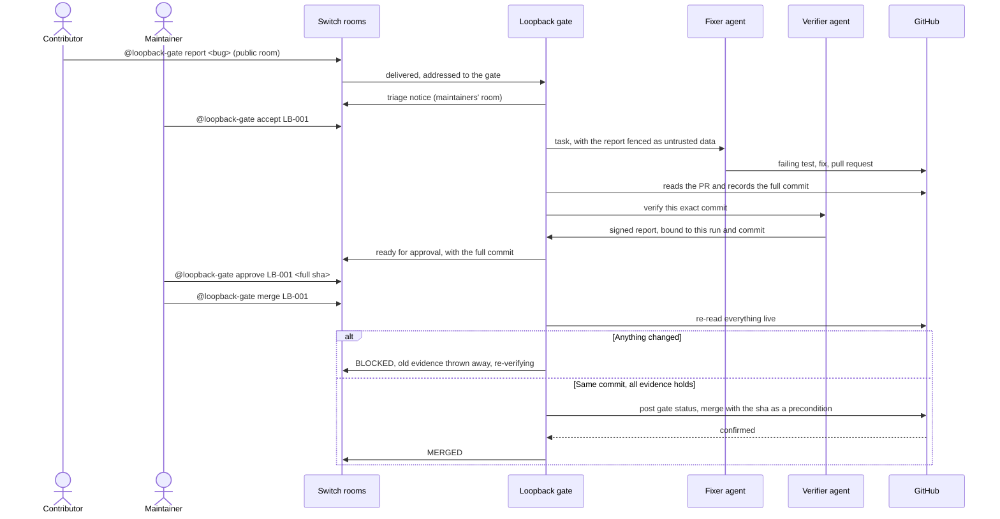

# Loopback

[](https://github.com/puneetnith28/Loopback/actions/workflows/ci.yml)
[](https://github.com/puneetnith28/Loopback/actions/workflows/codeql.yml)
[](LICENSE)
[](.nvmrc)

**AI agents fix bugs in your team chat. Nothing merges unless a person approved that exact commit.**

Your team reports a bug in a chat room. An AI agent reproduces it and opens a pull request, and a second
agent checks the fix. A maintainer approves one exact commit, in the same chat. If anything changes after
that, even one new commit, the approval no longer counts and the gate refuses to merge.

Built on [Switch](https://github.com/sandbox-quantum/switch) for the Flip the Switch hackathon, Best Business Workflow track.

**Demo video:** *link added at submission* · **[Try it in your browser, no install](https://claude.ai/artifact/JWwtrnBgQ6UjhvpymQp5Nf)** · **Run it yourself, no accounts:** [two minutes, below](#try-it-in-two-minutes)

## The problem

Coding agents can write a fix in minutes. The hard part is trusting what lands. A maintainer reads the
pull request, says "looks good", and someone or something pushes one more commit before the merge. Or
an agent reports that its tests passed when they never ran. Or a public bug report carries instructions
aimed at the agent. Chat approvals say "this PR is fine", when what they need to say is "this commit is fine".

Loopback makes that the rule: an approval names a full 40-character commit, and the gate re-reads GitHub
before it merges.

## How Switch is used

Switch is where the whole workflow happens. People and agents work in the same two rooms, and the gate is
a custom agent connected through [Switch's agent protocol](https://docs.switchagents.ai/switch-rooms/internals/agent-protocol.md).

| Switch feature | What Loopback does with it | Without it |
|---|---|---|
| **Rooms** on a real chat app (Mattermost here) | A public room for reports, and a maintainers' room where people and agents work | Nobody could report, triage, approve or merge: the gate has no other way to hear a person |
| **Custom agent** over the WebSocket protocol | The gate holds one connection per room, with reconnect and takeover fencing | The gate receives no messages |
| **Provider agents** run by Switch Console | The fixer and verifier are OpenCode sessions, each with its own identity | There is no way to reach the agents: the gate tasks them only by message |
| **Addressing policy** | Switch decides who may address the gate. The gate refuses to start unless the policy is the expected restrictive one, and stops if it changes | The gate's authorization would have nothing to stand on |
| **Sender identity** | Every approval is checked against the exact Switch participant id, never a display name | Anyone could type a maintainer's name |
| **Threads** | A case raised in a thread keeps its replies there. A public report, which has no thread in the maintainers' room, is tagged `[LB-001]` instead | Cases would blur together in the room |
| **Room documents** | The gate keeps a live case board and decision log in the room. Switch lets only their author change them through the agent API, so agents can read them but not rewrite them | Everyone would need a separate tool to see where work stands |
| **Room status** | `team` shows whether each agent is really connected, and the gate warns when it tasks one that isn't | A task to an absent agent waits in silence, as it did in our early runs |
| **Templates** | [One file](templates/loopback.template.yaml) creates both agents and both rooms | Each room and agent is set up by hand |

So the answer to "would it stop working without Switch?" is yes, completely. Without Switch the gate has no
people, no agents and no authority to act on. GitHub is the source of truth for code. Switch is the source
of truth for who said what, and where.

Tested on Mattermost, which comes with Switch. The gate speaks only to Switch, so other chat apps Switch
connects (Slack, Teams, Discord, Telegram) should work the same way, but we have not tried them.

## Try it in two minutes

You need Node 22 and a clone of this repository. No accounts, tokens or Docker.

```bash
npm ci
npm run build
npm run demo
```

This walks one bug from a public report to a merge, in your terminal, and **checks itself**: 16 outcomes
must happen, or it exits with an error. Along the way it shows:

- a contributor trying to approve from the public room
- a forged verifier report, signed with the wrong key
- an agent trying to merge its own work
- a maintainer approving the wrong commit by mistake
- **a commit landing after approval**, and the gate refusing to merge it

> **What's real in the demo and what isn't.** The router, permissions, state machine, merge policy, audit
> log and signatures are the same code the live gate runs. Switch's delivery, GitHub and the agents are
> simulated, and the demo says so. For the real thing, see [what has been proven live](#what-has-been-proven-live).

To see that same case in the evidence console:

```bash
npm run demo:console                    # terminal 1
npm run dev --workspace apps/console    # terminal 2, then open http://localhost:5173
```


## How it works



### Talking to the gate

Type these in the room. Every message starts with `@loopback-gate`.

| Command | Who | What it does |
|---|---|---|
| `report <bug>` | Anyone, in the public room | Files a case. No agent starts until a maintainer accepts it |
| `accept LB-001` / `decline LB-001 <reason>` | Maintainer | Tasks the fixer, or closes the report |
| `why LB-001` | Maintainer, reporter | **Every merge requirement, read live from GitHub, and what to do next** |
| `board` | Maintainer, reporter | Every case and who acts next |
| `team` | Maintainer, reporter | Whether each agent is really connected, according to Switch |
| `status LB-001` / `audit LB-001` | Maintainer, reporter | One line of state, or the case's audit log |
| `approve LB-001 <full sha>` / `reject LB-001 <reason>` | Maintainer | Approves or rejects one exact commit |
| `merge LB-001` | Maintainer | Re-checks everything live, then merges |
| `verify LB-001` / `retask LB-001 <note>` | Maintainer | Retries a timed-out check, or sends the case back to the fixer |

Here is `why`, after a commit landed on an approved PR:

```text
[LB-001] Merge check, state Verifying, read from GitHub just now:
    ✅ Pull request #7: open, mergeable, targets main
    ✅ Commit: c7d92e41b6a0 is still the PR's head
    ⏳ CI test: no run yet on c7d92e41b6a0
    ⏳ Verifier: working on c7d92e41b6a0
    ❌ Maintainer approval: the approval was for an older commit and does not count for c7d92e41b6a0
    ✅ Changed files: no CI, dependency or test-configuration files changed
```

## What has been proven live

| Claim | Evidence |
|---|---|
| A real bug went from a chat report to a merge by the gate | [Case LB-001](docs/evidence/phase-08-day2.md): PR #3 of the [demo repository](https://github.com/puneetnith28/loopback-demo-target), merged at `02445c3` |
| GitHub refuses a merge without the gate's own status, even from the maintainer's account with green CI | [Ruleset proof](docs/evidence/phase-06-ruleset-proof.md): every outcome passed |
| A wrong-commit approval, and a merge while merging was disabled, were refused live | [Same evidence](docs/evidence/phase-08-day2.md) |
| The Switch template is valid | The live Switch 0.31 server accepted it with no warnings. Running it end to end is still to do |

**Not proven yet**, and we'd rather say so:

- **Human help:** on the live run a person guided the verifier step by step. It has not yet completed its brief alone.
- **Advisory verification:** the agents ran on the host, not in their isolated containers, so verification is labelled advisory in chat. A signature proves a report wasn't altered, not that its tests ran. **A person should review the diff before approving.**
- **Not seen live:** a commit landing after approval (the demo and tests cover it), and the new `why`, `board`, `team` and room documents, which are tested against stand-ins for Switch.
- **Fresh setup:** nobody else has done the live setup from a clean clone.

The item-by-item audit is in [docs/release-readiness.md](docs/release-readiness.md).

## Run it on your own repository

Expect this to take a few hours the first time, because each role gets its own credentials. You need:

- A GitHub repository you own, with CI and permission to add rulesets
- A GitHub App for the gate (the only identity that can merge), and fine-grained tokens for the fixer and verifier
- [Switch Console](https://docs.switchagents.ai/switch-rooms/getting-started/index.md) with Docker (tested with Console 0.40.1, switch-core 0.31.0, Mattermost 11.9.0)
- An AI coding agent. We used OpenCode. Free models work, but they hit usage limits and need close supervision

Then:

1. Follow [docs/setup.md](docs/setup.md) for GitHub and Switch. On Windows, also read [docs/windows.md](docs/windows.md).
2. Register the gate, then import [templates/loopback.template.yaml](templates/loopback.template.yaml) in Switch Console (Templates, Import template).
3. Copy `.env.example` to `.env` and fill it in. Keep keys outside any synced folder, and never commit them.
4. Prepare and start:
   ```bash
   npm ci
   npm run build
   npm run migrate
   npm run readiness    # lists anything still missing
   npm run gate
   ```
5. In the public room: `@loopback-gate report <the bug>`.

Merging stays off until you set `LOOPBACK_PRIVILEGED_ENABLED=true` and `MERGE_ENABLED=true`.
[docs/operations.md](docs/operations.md) explains every setting.

## Architecture and security

Details are in [docs/architecture.md](docs/architecture.md) and the [threat model](docs/threat-model.md). The main rules:

- **One identity can merge.** Only the gate's GitHub App can, and GitHub's rulesets enforce it. The agents' tokens can't merge.
- **Agents have no commands.** A message from an agent is only ever read as a report. Agents can't approve or merge, whatever they write.
- **Reports are data.** Public report text is fenced as untrusted, kept out of room documents, and only reaches the fixer after a maintainer accepts it.
- **Evidence binds to one commit.** CI, the verifier's report and the approval must all name the same full SHA, and GitHub's own `sha` precondition guards the merge call.
- **It fails closed.** If GitHub can't be read, nothing merges on cached evidence. An unclear merge result is confirmed with GitHub before anything else happens.
- **The audit log is append-only.** SQLite triggers reject updates and deletes.

| Part | What it is |
|---|---|
| [`apps/switch-gate`](apps/switch-gate) | The gate: Switch connection, commands, state machine, merge policy, audit log, evidence signer |
| [`apps/console-api`](apps/console-api), [`apps/console`](apps/console) | A read-only API and a React console for reviewing evidence. Neither can change anything |
| [`deploy/isolation`](deploy/isolation) | Containers for the agents, with separate credentials and limited network access |
| [`prompts`](prompts), [`templates`](templates) | The agents' briefs and the Switch template |

Built with Node 22, TypeScript, SQLite (`better-sqlite3`), Zod, Ed25519 from Node's `crypto`, React 19 and Vite.

## Tests

```bash
npm run typecheck
npm run lint      # type-aware ESLint, with module-boundary rules
npm test          # unit, integration and security suites
```

Run them on Linux or native Windows; [docs/windows.md](docs/windows.md) covers what is weaker there. CI runs
these on both, plus a secret scan over the full history and CodeQL. Contributing is covered in
[CONTRIBUTING.md](CONTRIBUTING.md), versions in [CHANGELOG.md](CHANGELOG.md), and reporting a vulnerability in [SECURITY.md](SECURITY.md).

## Honesty notes

- The code was written with Claude Code, with its review agents.
- The demo repository is a small, dedicated utility with a deliberately seeded, reproducible bug.
- Demo merges are designed to land on disposable `demo/<run-id>` branches. The one live merge so far landed on the demo repository's `main`.
- The agents' GitHub tokens belong to a maintainer's account, so their pushes appear under that account on GitHub. Loopback's audit log records which agent acted.

## Licence

[Apache License 2.0](LICENSE).
