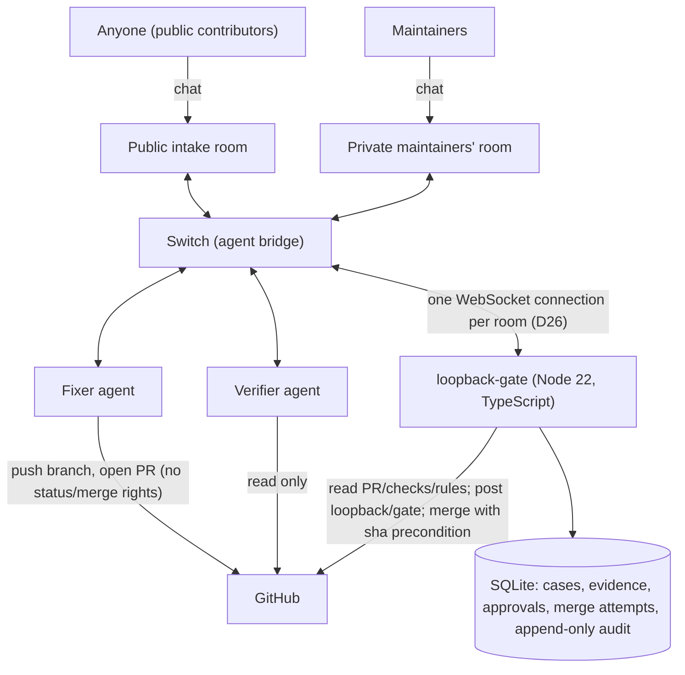

# Architecture



## Modules (`apps/switch-gate/src`)

| Module | Responsibility |
|---|---|
| `config.ts` | Per-group, fail-closed configuration; never echoes values |
| `commands/` | Closed command grammar (`parse.ts`) and routing with audited refusals (`router.ts`) |
| `policy/` | Pure functions only: roles and authorization, `evaluateMerge`, invariants |
| `cases/` | State machine with guarded exceptions, transactional transitions, per-case lock, merge executor and reconciliation |
| `workflow/` | Fixer hand-off, verification requests and report ingestion, timeouts, approvals, retask, GitHub poller |
| `github/` | Typed REST client over `fetch` with App auth; the isolated merge call |
| `persistence/` | Migrations and typed repositories |
| `audit/` | Append-only audit log with redaction |
| `agents/` | Extraction of `loopback-report` blocks from untrusted agent output; report signatures (`signature.ts`); D29 run capabilities (`capability.ts`) |
| `signer/` | D29 verifier signer service (runs only in the `loopback-signer` container): request policy, replay store, HTTP boundary, live-head reader, entry point |
| `chat/` | Refusal wording, status/audit rendering, escaping |
| `switch/` | Switch transport: one connection per room (`rooms.ts`, `connection.ts`), room-keyed posting (`chat.ts`), connection records (`store.ts`), operation discovery and `read_context` (`ops.ts`), delivery-gap recovery (`gap.ts`), addressing-policy self-check (`policy-check.ts`) |
| `observability/` | Redacting logger, loopback-only health endpoints |
| `startup.ts` | Preflight (identity, policy), the periodic policy watch, readiness checks |
| `app.ts`, `main.ts` | Composition root and entry point |

Lint boundaries (tested in `tests/unit/lint-boundaries.test.ts`): `policy/` imports only the
contracts; the merge call is reachable only from `cases/service.ts` and the composition root
(`app.ts`, which injects it); only `github/*` and the composition root may import the raw GitHub
transport; audit internals are reachable only through `audit/index`; `signer/` imports only the
contracts, `zod`, Node built-ins, `agents/{signature,capability}` and its siblings (D29).

## Rooms (D26)

The gate serves two Switch rooms over two connections of the same agent identity (a
`scope=single` connection holds one room, and threaded replies go to that room):

| | Maintainers' room (private) | Intake room (public) |
|---|---|---|
| Who Switch admits to address the gate | Exactly `SWITCH_POLICY_USER_IDS` and the fixer/verifier `SWITCH_POLICY_AGENT_IDS` | Any person (`users: "*"`), no agents (`agents: []`) |
| Commands | All, by role; privileged ones only with `LOOPBACK_PRIVILEGED_ENABLED=true` | `help`, `report`, `status` (own reports only) |
| Agent reports | Accepted from the exact fixer/verifier ids | Refused (`WRONG_ROOM`) |
| Refusals (D27) | Precise reason for maintainers; generic text for anyone else | Generic text, rate-limited per sender |

A public report becomes a case in `Reported` and a triage notice in the maintainers' room; only
a maintainer's `accept` tasks the fixer (`decline` blocks it with `TRIAGE_DECLINED`). Each room
keeps its own connection record (`switch_connection:<room id>`); the maintainers' room adopts the
record saved before rooms were split, so an upgraded gate reattaches fenced. If either connection
stops for good, both stop and the process exits (all-or-nothing).

If Switch reports a delivery gap, the gate reads the room's recent history (`read_context`),
records unprocessed messages aimed at it in the audit log, tells maintainers how many to resend
(never the content), and reconciles every case against GitHub. Recovered messages are **never
executed**: `read_context` carries no `addressed` flag, so they cannot pass admission.

## Verifier signing boundary (D29)

```
gate ──(chat: verify request + "Signing capability: lbcap1…", signed with the gate's run-issuer key)──▶ verifier
verifier ──(jobs volume: tree copy + argv)──▶ runner (--network none, no credentials)  ──(results volume)──▶ verifier
verifier ──(loopback-signer-net: Bearer client token, capability, report, digest)──▶ signer
signer ──(loopback-proxy-signer: api.github.com only)──▶ GitHub: PR open at exactly that head?
signer ──(signature over the canonical report)──▶ verifier ──(chat: signed loopback-report)──▶ gate
gate: signature (signer public key) ▸ run, case, repository, PR, SHA ▸ live head ▸ superseded/expired runs
```

- The private signing key exists only in the signer's volume (uid 10003). The verifier holds a
  client token, never a key; the runner, which executes PR code, holds neither and cannot reach
  the signer (no network).
- The signer signs only a schema-valid, unsigned report whose SHA-256 digest matches, bound to a
  gate-issued, unexpired capability for the same run, case, repository, PR and full head SHA, for
  its one configured repository, while that PR is open at that head on GitHub, and only once per
  run (claimed atomically, durably).
- The gate's own checks are unchanged (D28): a signature is necessary in isolated mode, never
  sufficient.
- What a signature still does not prove: that the tests were run or the verdict is true. D29
  protects key custody, not verdict integrity: a compromised verifier container can obtain the one
  signature of each run it reaches first until it is recycled (`agents.sh recycle-verifier`), and
  PR code controls its own test results (docs/threat-model.md).
- Follow-ups not built (recorded, not claimed): attested execution (a trusted dispatcher runs the
  tests in per-job containers and signs the execution facts), per-run ephemeral verifier
  credentials delivered out of band, and the capability hash inside the signed report.

## Trust boundaries

| Component | Trusted for | Never trusted for |
|---|---|---|
| Switch | Delivering messages and the sender's participant id | Proof that GitHub policy was enforced |
| Fixer | Doing the work | Claims that tests passed or a PR exists |
| Verifier | A second opinion, as structured evidence bound to a run and to the PR's live head; **advisory** (labelled so) until `VERIFIER_ISOLATION_PROVEN=true` (D28) | Approving or merging; holding a signing key (D29) |
| Verifier signer (D29) | Signing at most one report per gate-issued run, for a live head | Judging whether the verdict is true |
| Runner sandbox (D29) | Executing PR code where it can reach nothing | Its own results (produced next to PR code) |
| Public intake room | Receiving a report and its sender id | Anything beyond `help`, `report`, `status`; tasking the fixer |
| Gatekeeper | Policy decisions | Its own past state when GitHub disagrees |
| GitHub | Repository, PR, commit, CI and merge state | — |

## Case lifecycle

`Reported → Triaged → FixInProgress → PRCreated → Verifying → AwaitingApproval → ReadyToMerge →
Revalidating → Merging → Merged`, with `Stale`, `VerificationFailed`, `Blocked` and
`MergeUnknown` as the specified side states. Public reports wait in `Reported` until a
maintainer's `accept` (`Reported → Triaged → FixInProgress`) or `decline` (`→ Blocked`). Two exceptions to the specified table exist (D18):
`Blocked → Revalidating` only for transient reasons on a maintainer `merge`, and open-PR states
`→ Blocked` only when GitHub shows the PR closed. Reconciliation can never reach `Merging`.
