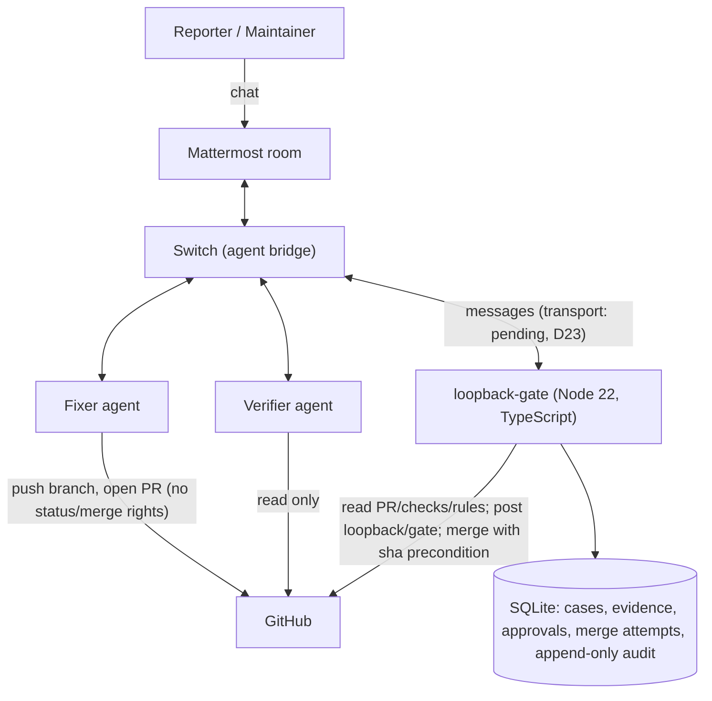

# Architecture

## Modules (`apps/switch-gate/src`)

| Module | Responsibility |
|---|---|
| `config.ts` | Per-group, fail-closed configuration; never echoes values |
| `commands/` | Closed command grammar (`parse.ts`) and routing with audited refusals (`router.ts`) |
| `policy/` | Pure functions only: roles and authorization, `evaluateMerge`, invariants |
| `cases/` | State machine with guarded exceptions, transactional transitions, per-case lock, merge executor and reconciliation |
| `workflow/` | Fixer hand-off, verification requests and report ingestion, timeouts, approvals, retask, GitHub poller |
| `github/` | Typed REST client over `fetch` with App auth; the isolated merge call |
| `persistence/` | Migrations and typed repositories |
| `audit/` | Append-only audit log with redaction |
| `agents/` | Extraction of `loopback-report` blocks from untrusted agent output |
| `chat/` | Refusal wording, status/audit rendering, escaping |
| `observability/` | Redacting logger, loopback-only health endpoints |
| `app.ts`, `main.ts` | Composition root and entry point |

Lint boundaries (tested in `tests/unit/lint-boundaries.test.ts`): `policy/` imports only the
contracts; the merge call is reachable only from `cases/service.ts` and the composition root
(`app.ts`, which injects it); only `github/*` and the composition root may import the raw GitHub
transport; audit internals are reachable only through `audit/index`.

## Trust boundaries

| Component | Trusted for | Never trusted for |
|---|---|---|
| Switch | Delivering messages and the sender's participant id | Proof that GitHub policy was enforced |
| Fixer | Doing the work | Claims that tests passed or a PR exists |
| Verifier | An independent second opinion, as structured evidence bound to a run | Approving or merging |
| Gatekeeper | Policy decisions | Its own past state when GitHub disagrees |
| GitHub | Repository, PR, commit, CI and merge state | — |

## Case lifecycle

`Reported → Triaged → FixInProgress → PRCreated → Verifying → AwaitingApproval → ReadyToMerge →
Revalidating → Merging → Merged`, with `Stale`, `VerificationFailed`, `Blocked` and
`MergeUnknown` as the specified side states. Two exceptions to the specified table exist (D18):
`Blocked → Revalidating` only for transient reasons on a maintainer `merge`, and open-PR states
`→ Blocked` only when GitHub shows the PR closed. Reconciliation can never reach `Merging`.
