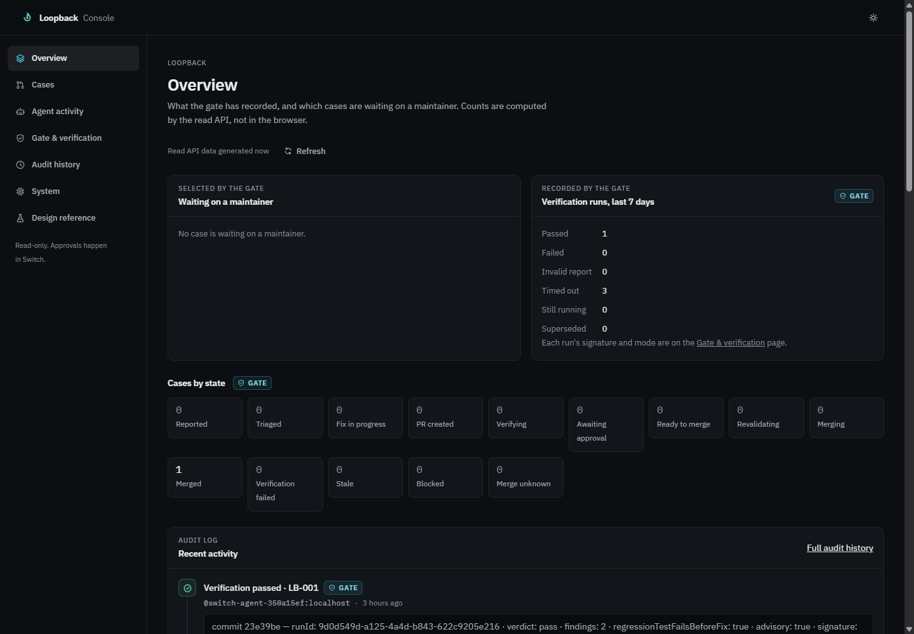
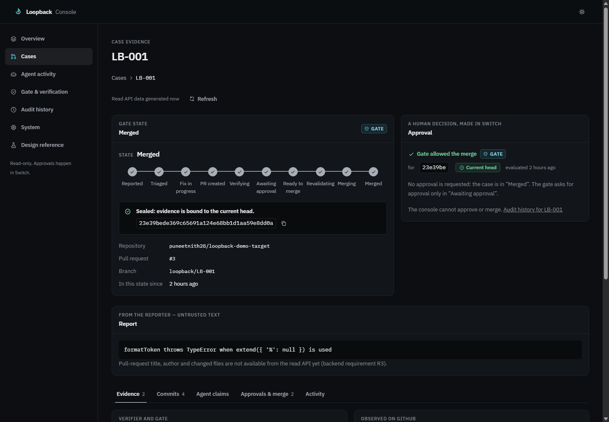

# Console on real data

Recorded 2026-11-05. The real console (Vite dev server) read the real console API, on a copy of the
archived `LB-001` database, in headless Chrome. The proxy held the token, and no secret appears here.

## API checks on the same data

| Check | Result |
|---|---|
| `/health` without a token | 200 |
| `/cases` without a token | 401 |
| `/cases` | `LB-001`, `Merged` |
| `/cases/LB-001/verification-runs` | 1 `pass` with signature `valid`, 3 `timeout` |
| `/cases/LB-001/approvals` | 1 item |
| `/cases/LB-001/audit`, `/audit` | 41 and 47 events |
| A `POST` | 405 |
| Secret-like strings across the responses checked | 0 |

## Bugs found only by looking at the page

Each side passed its own tests, so none of these failed in the suite until now.

| Shown | True | Cause | Fix |
|---|---|---|---|
| Failed 3, Timed out 0, Still running 4, Invalid 1 | Timed out 3, the others 0 | The browser estimated run counts from recent audit events | The API counts runs itself |
| "The gate has not evaluated a merge" on a merged case | It merged | The field was hardcoded to null | Worked out from the recorded merge or block |
| "Data generated 2 hours ago" | Generated just now | Freshness used the record's own timestamps | Uses the response time |

The first fix to the second bug also missed: a unit test passed while the page still showed the old text,
because the fix was on a parsing path the page doesn't use. It now has a test using the API's real
example response.

## What this does not prove

The console was checked on a browser against stored data, not during a live run. Pull-request title,
author and changed files are not available from the API, and the page says so.
